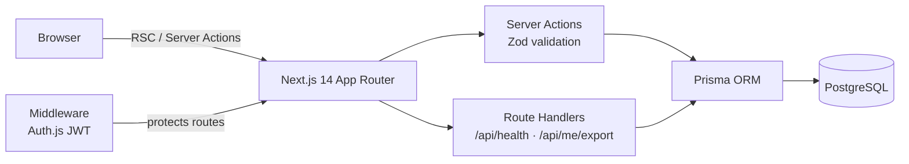
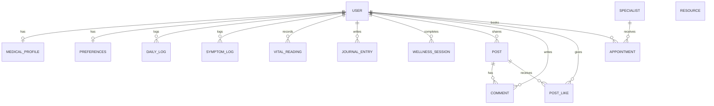

# 💗 SheCare — A Digital Companion for Women Battling Breast Cancer

SheCare started at **Startup Weekend Algiers 2025** as a frontend prototype. **v2** turns it into a complete full-stack application: real accounts, a PostgreSQL database, and every page backed by live data.

## 🧩 The Problem

Women going through breast cancer treatment have to juggle appointments, symptoms, nutrition and their mental health — often alone, with information scattered everywhere.

## ✨ Features

| Module | What you can do |
|--------|-----------------|
| 🔐 **Accounts** | Sign up, sign in, change password, export all your data (JSON), delete your account |
| 📊 **Dashboard** | Treatment days, wellness score trend, next appointment, treatment cycle progress, recent activity — all computed from your data |
| 🩺 **Health tracker** | Daily check-in (energy, mood, sleep, water), symptom log with severity, vital signs, full history |
| 🧘 **Wellness hub** | Guided meditation, breathing and music sessions, private journal with prompts, weekly stats and day streak |
| 💬 **Community** | Share stories by category, hearts, comments, pagination — with an option to post anonymously |
| 👩‍⚕️ **Consultations** | Book specialists by video, phone or chat; slots computed from opening hours; double-booking prevented; cancel upcoming appointments |
| 📚 **Resources** | Searchable library of articles, videos and PDFs, filter by type, article pages |
| 👤 **Profile** | Personal and medical information, notification and privacy preferences |

## 🏗️ Architecture

- **No separate API server**: reads happen in React Server Components, writes go through **Server Actions**.
- **Every input is validated on the server** with Zod; errors are returned per field and shown in the form.
- **Authorization is enforced in every query** (`where: { id, userId }`), so a user can never read or modify someone else's records.
- **Bookings run in a serializable transaction** that checks overlaps for both the specialist and the patient, so two people cannot take the same slot.
- **Passwords** are hashed with bcrypt (cost 12); the export endpoint never includes the hash.

## 🗄️ Data Model

Deleting a user cascades to all of their data. The full schema is in [`prisma/schema.prisma`](prisma/schema.prisma).
